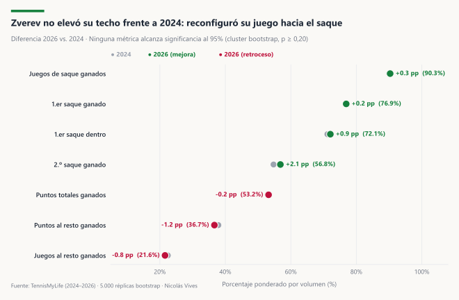
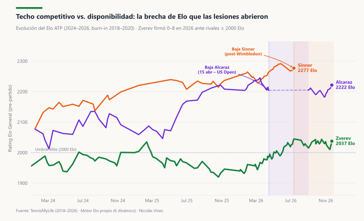
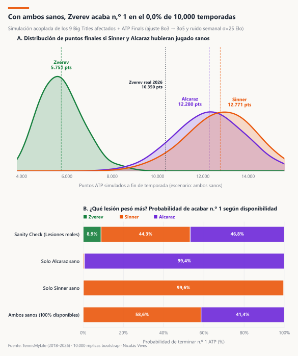
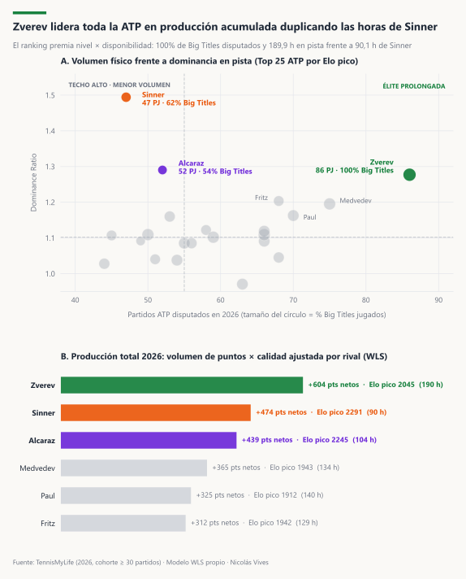

<a id="top"></a>

<p align="center">
  <strong>🌐 Language / Idioma:</strong>&nbsp;
  <a href="#es">🇪🇸 Español</a> &nbsp;|&nbsp;
  <a href="#en">🇬🇧 English</a>
</p>

---

<a id="es"></a>

# ¿Mejoró realmente Alexander Zverev en 2026 o fue n.º 1 por las lesiones de Sinner y Alcaraz?

Estudio cuantitativo de la temporada ATP 2026 (incluyendo las ATP Finals de Turín) orientado a responder una pregunta central: **¿cuánto del n.º 1 de fin de año de Alexander Zverev se explica por un salto real en su nivel de juego y cuánto por las ausencias de Jannik Sinner y Carlos Alcaraz?**

## Resumen ejecutivo

La respuesta que arrojan los datos no es binaria: **Zverev no elevó su techo de juego respecto a 2024 y dependió de las lesiones para alcanzar el n.º 1, pero lideró toda la ATP en producción acumulada gracias a una durabilidad y consistencia excepcionales.**

| Bloque analítico | Hallazgo principal | Evidencia clave |
| :--- | :--- | :--- |
| **1. Nivel intrínseco** | Rebote real al saque frente a 2025, pero **nivel global plano frente a 2024**. | vs. 2025: `+3,80 pp` en *Hold %* ($p=0{,}018$).<br>vs. 2024: `DR` idéntico (`1,28`; $p=0{,}976$) y 0/8 métricas significativas. |
| **2. Calidad del rival (Elo + WLS)** | Suelo altísimo frente al circuito, pero **0 % de victorias ante rivales de élite (`Elo >= 2000`)**. | `adj_tpw_plus` de `+4,14` (calcado al `+4,12` de 2024; $p=0{,}979$), lejos de Sinner (`+6,78`) y Alcaraz (`+5,32`). Balance **0–8** vs. Elo $\ge 2000$. |
| **3. Contrafactual (Montecarlo)** | Sin las lesiones, **Zverev acaba n.º 1 en el 0,0 % de 10.000 temporadas simuladas**. | Incluso con las lesiones reales (*Sanity Check*), su probabilidad Elo era del **8,9 %**: superó su expectativa en **+3.891 puntos** capitalizando los *upsets* de Sinner en RG y Alcaraz en el US Open. |
| **4. Durabilidad vs. Techo** | **Líder absoluto de la ATP en valor acumulado**, duplicando el volumen físico de Sinner. | **+604,5** puntos netos sobre la media ATP (vs. `+474,0` Sinner y `+438,7` Alcaraz) con **100 % de disponibilidad** en *Big Titles* y **189,9 h** en pista. |

---

## Resultados detallados

### Bloque 1 · Nivel intrínseco: rebote tras 2025, no ruptura frente a 2024

Comparar 2026 exclusivamente con un 2025 irregular genera la ilusión de una transformación histórica. Al incorporar su techo previo de 2024 y evaluar las diferencias mediante *cluster bootstrap* a nivel partido (5.000 réplicas), emergen dos realidades distintas:

* **Frente a 2025 (rebote real al servicio):** mejora estadísticamente significativa al 95 % en tres palancas del saque —1.er saque ganado (`+3,12 pp`, $p=0{,}0056$), 2.º saque ganado (`+3,25 pp`, $p=0{,}0392$) y juegos de saque ganados (`+3,80 pp`, $p=0{,}0184$).
* **Frente a 2024 (reconfiguración sin salto global):** ninguna de las 8 métricas evaluadas resulta estadísticamente significativa ($p \ge 0{,}20$ en todas). Su *Dominance Ratio* (`1,28`) y porcentaje de puntos totales ganados (`53,20 %` vs. `53,41 %`) permanecen estables: un ligero avance en 2.º saque (`+2,09 pp`) compensa una ligera cesión al resto (`-1,20 pp`).

| Métrica (ponderada por puntos) | 2024 | 2025 | 2026 | Diff 26 vs 24 ($p$) | Diff 26 vs 25 ($p$) |
| :--- | :---: | :---: | :---: | :---: | :---: |
| Partidos disputados | 88 | 80 | 86 | — | — |
| Victorias (%) | 77,27 % | 68,75 % | 77,91 % | — | — |
| Total Points Won (`TPW%`) | 53,41 % | 52,23 % | 53,20 % | -0,21 pp (0,744) | +0,97 pp (0,189) |
| Dominance Ratio (`DR`) | 1,28 | 1,18 | 1,28 | 0,00 (0,976) | +0,10 (0,097) |
| 1.er saque ganado (%) | 76,73 % | 73,79 % | 76,91 % | +0,18 pp (0,897) | **+3,12 pp (0,006)\*** |
| 2.º saque ganado (%) | 54,72 % | 53,56 % | 56,81 % | +2,09 pp (0,201) | **+3,25 pp (0,039)\*** |
| Juegos de saque ganados (`Hold%`) | 90,03 % | 86,53 % | 90,33 % | +0,31 pp (0,854) | **+3,80 pp (0,018)\*** |
| Puntos al resto ganados (%) | 37,86 % | 37,51 % | 36,66 % | -1,20 pp (0,258) | -0,85 pp (0,472) |



---

### Bloque 2 · Calidad del rival (Elo híbrido y modelo WLS)

Mediante un motor Elo dinámico por superficie (con *burn-in* 2018–2020) y una regresión lineal ponderada (`WLS`) que aísla la ventaja sobre un jugador ATP medio controlando por el Elo del rival, la superficie y el formato (`adj_tpw_plus`), se desmontan dos simplificaciones habituales:

1. **Su calendario promedio no fue fácil, pero no venció a la súper-élite:** el Elo medio de sus rivales (`1787,8`) fue el más alto de todo su periodo 2021–2026 por alcanzar 22 partidos en rondas finales (QF/SF/F) de Grand Slams y Masters 1000 —donde firmó su mejor rendimiento ajustado de carrera (`+4,70`). Sin embargo, frente a rivales con `Elo >= 2000` registró un **0–8 (0 %)** —incluyendo las finales de Madrid, Wimbledon y las ATP Finals.
2. **Brecha clara de techo competitivo frente a Sinner y Alcaraz:** su rendimiento global ajustado por rival (`+4,14`) es prácticamente idéntico al de 2024 (`+4,12`, $p=0{,}979$), mientras Sinner (`+6,78`, Elo pico `2291`) y Alcaraz (`+5,32`, Elo pico `2245`) operaron en un escalón superior cuando estuvieron en pista.

| Jugador (2026) | Partidos | Elo Pico | Elo Medio Rival | `TPW%` Bruto | `adj_tpw_plus` (vs. media ATP) |
| :--- | :---: | :---: | :---: | :---: | :---: |
| **Jannik Sinner** | 47 | 2291,4 | 1773,4 | 55,87 % | **+6,78 pp** |
| **Carlos Alcaraz** | 52 | 2245,3 | 1803,1 | 54,23 % | **+5,32 pp** |
| **Alexander Zverev** | 86 | 2044,8 | 1787,8 | 53,20 % | **+4,14 pp** |



---

### Bloque 3 · Simulación de Montecarlo: el contrafactual de las lesiones

Partiendo de los puntos reales fijos del primer trimestre y torneos ATP 500/250, se ejecutaron **10.000 simulaciones acopladas** de los 9 *Big Titles* afectados (Madrid a París) más las ATP Finals de Turín bajo cuatro configuraciones de disponibilidad (baja de Alcaraz del 15 de abril al US Open; baja de Sinner tras Wimbledon hasta fin de año).

| Escenario (10.000 simulaciones) | P(Zverev #1) | P(Sinner #1) | P(Alcaraz #1) | Media Pts Zverev | Media Pts Sinner | Media Pts Alcaraz |
| :--- | :---: | :---: | :---: | :---: | :---: | :---: |
| **Sanity Check (Lesiones reales)** | 8,9 % | 44,3 % | 46,8 % | 6.459 | 7.996 | 8.106 |
| **Solo Alcaraz sano** | 0,1 % | 0,5 % | 99,4 % | 6.074 | 7.597 | 12.922 |
| **Solo Sinner sano** | 0,1 % | 99,6 % | 0,3 % | 6.090 | 13.259 | 7.594 |
| **Ambos sanos (100 % disponibles)** | **0,0 %** | **58,6 %** | **41,4 %** | 5.751 | 12.770 | 12.280 |

*Referencia real al cierre tras las ATP Finals (22 nov 2026): Zverev **10.350** (#1, finalista en Turín), Sinner **7.950** (#2, ausente) y Alcaraz **7.600** (#3, campeón invicto en Turín).*

**Lectura clave del *Sanity Check*:** el modelo reproduce casi exactamente los totales reales de Sinner (`7.996` vs. `7.950`) y se aproxima al de Alcaraz (`8.106` vs. `7.600`, diferencia atribuible al óxido competitivo tras cuatro meses de baja en US Open y Shanghái). Por el contrario, Zverev terminó **+3.891 puntos por encima de su expectativa Elo**: las lesiones fueron una condición necesaria (de `0,0 %` a `8,9 %`), pero su mérito decisivo fue situarse en la cola derecha de esa distribución al aprovechar las caídas tempranas de Sinner en Roland Garros (R64) y Alcaraz en el US Open (QF) para ganar ambos títulos.



---

### Bloque 4 · Durabilidad vs. techo competitivo

El ranking ATP no premia el pico instantáneo, sino la integral de nivel por disponibilidad. Al multiplicar el volumen de puntos disputados por la ventaja ajustada por rival (`net_pts_above_avg`), Zverev supera con claridad a todo el circuito:

| Jugador (Top 5 por valor acumulado) | Partidos | Horas en pista | Disponibilidad *Big Titles* | Elo Pico | `DR` | Pts / *Big Title* | **Valor acumulado (`net_pts_above_avg`)** |
| :--- | :---: | :---: | :---: | :---: | :---: | :---: | :---: |
| **1. Alexander Zverev** | **86** | **189,9 h** | **100,0 %** | 2044,8 | 1,28 | 662,3 | **+604,5** |
| **2. Jannik Sinner** | 47 | 90,1 h | 61,5 % | **2291,4** | **1,49** | **981,3** | +474,0 |
| **3. Carlos Alcaraz** | 52 | 103,8 h | 53,8 % | 2245,3 | 1,29 | 650,0 | +438,7 |
| **4. Daniil Medvedev** | 75 | 134,2 h | 100,0 % | 1943,0 | 1,20 | 174,6 | +365,1 |
| **5. Tommy Paul** | 70 | 140,4 h | 92,3 % | 1912,3 | 1,16 | 130,0 | +325,1 |



---

## Arquitectura del repositorio

```text
zverev-2026-analysis/
├── data/
│   ├── raw/                        # CSVs anuales de TennisMyLife (2018.csv – 2026.csv)
│   └── processed/                  # Datasets limpios en formato Parquet
├── docs/
│   └── methodology.md              # Decisiones estadísticas, ecuaciones y limitaciones
├── figures/                        # Gráficos editoriales exportados a 300 DPI
├── notebooks/
│   ├── 01_intrinsic_level.ipynb    # Nivel intrínseco y cluster bootstrap (2021–2026)
│   ├── 02_opponent_adjusted.ipynb  # Motor Elo dinámico y modelo WLS por rival
│   ├── 03_injury_counterfactual.ipynb # Simulación de Montecarlo acoplada (10.000 runs)
│   └── 04_durability_vs_peak.ipynb # Carga física, disponibilidad y valor acumulado
├── src/
│   ├── ingestion.py                # Carga y transformación a formato jugador-partido
│   ├── metrics.py                  # Métricas ponderadas y bootstrap por partido
│   ├── elo.py                      # Elo híbrido por superficie y regresión WLS
│   ├── simulation.py               # Simulador vectorizado de cuadros y ATP Finals
│   └── durability.py               # Eficiencia en Big Titles y producción acumulada
├── requirements.txt
└── README.md
```

## Reproducibilidad

1. **Fuente de datos:** los archivos anuales `2018.csv` a `2026.csv` provienen de la base de datos abierta de [TennisMyLife](https://stats.tennismylife.org/tennis-match-database) y deben colocarse en `data/raw/`.
2. **Instalación del entorno:**
   ```bash
   pip install -r requirements.txt
   ```
   *(Dependencias principales: `pandas`, `numpy`, `pyarrow`, `statsmodels`, `matplotlib`).*
3. **Ejecución:** ejecutar secuencialmente los notebooks `01` a `04` en `notebooks/`. Todos los procesos estocásticos (*bootstrap* y Montecarlo) utilizan semilla fija (`seed=42`) para garantizar reproducibilidad exacta.

Para el detalle matemático de cada bloque y la discusión de supuestos y limitaciones, consultar [docs/methodology.md](docs/methodology.md#es).

...

<p align="right"><a href="#top">↑ Volver arriba</a> · <a href="#en">Read in English 🇬🇧</a></p>

---

<a id="en"></a>

# Did Alexander Zverev Truly Level Up in 2026, or Did Injuries Hand Him Year-End No. 1?

A quantitative audit of the 2026 ATP season (including the ATP Finals in Turin) designed to answer one core question: **how much of Alexander Zverev’s Year-End No. 1 finish reflects a genuine leap in playing level, and how much was driven by Jannik Sinner’s and Carlos Alcaraz’s injuries?**

## Executive Summary

The data rejects both extreme narratives: **Zverev did not raise his performance ceiling relative to 2024 and relied on his rivals' absences to reach No. 1—yet he led the entire ATP Tour in cumulative value through exceptional durability and consistency.**

| Analytical Module | Core Finding | Key Evidence |
| :--- | :--- | :--- |
| **1. Intrinsic Level** | Real serving rebound vs. 2025, but **flat overall level vs. 2024**. | vs. 2025: `+3.80 pp` Hold% ($p=0.018$).<br>vs. 2024: identical `DR` (`1.28`; $p=0.976$) and 0/8 statistically significant metrics. |
| **2. Opponent Quality (Elo + WLS)** | Elite floor against the field, but **0% win rate vs. top-tier opponents (`Elo >= 2000`)**. | `adj_tpw_plus` of `+4.14` (virtually identical to 2024’s `+4.12`; $p=0.979$), trailing Sinner (`+6.78`) and Alcaraz (`+5.32`). **0–8** record vs. Elo $\ge 2000$. |
| **3. Counterfactual (Monte Carlo)** | With both rivals healthy, **Zverev finishes No. 1 in 0.0% of 10,000 simulated seasons**. | Even under actual injury windows (*Sanity Check*), his Elo-implied odds were just **8.9%**: he outperformed expectation by **+3,891 pts**, capitalizing on Sinner’s RG upset and Alcaraz’s US Open QF exit. |
| **4. Durability vs. Ceiling** | **No. 1 across the entire ATP in cumulative value**, doubling Sinner’s court volume. | **+604.5** net points above ATP average (vs. `+474.0` Sinner and `+438.7` Alcaraz) with **100% Big Title availability** and **189.9 hours** on court. |

---

## Detailed Findings

### Module 1 · Intrinsic Level: A Rebound from 2025, Not a Breakthrough vs. 2024

Comparing 2026 solely against an uneven 2025 campaign creates the illusion of a historic leap. Benchmarking against his previous peak (2024) via match-level cluster bootstrap (5,000 resamples) separates signal from noise:

* **vs. 2025 (genuine serving rebound):** statistically significant gains at the 95% level across three serving pillars—1st-serve points won (`+3.12 pp`, $p=0.0056$), 2nd-serve points won (`+3.25 pp`, $p=0.0392$), and service games held (`+3.80 pp`, $p=0.0184$).
* **vs. 2024 (reconfiguration without an overall ceiling jump):** none of the 8 evaluated metrics reach statistical significance ($p \ge 0.20$ across the board). Dominance Ratio (`1.28`) and Total Points Won (`53.20%` vs. `53.41%`) remain effectively flat, with modest 2nd-serve gains (`+2.09 pp`) offset by a slight dip on return (`-1.20 pp`).

| Metric (point-weighted) | 2024 | 2025 | 2026 | Diff 26 vs. 24 ($p$) | Diff 26 vs. 25 ($p$) |
| :--- | :---: | :---: | :---: | :---: | :---: |
| Matches played | 88 | 80 | 86 | — | — |
| Win rate (%) | 77.27% | 68.75% | 77.91% | — | — |
| Total Points Won (`TPW%`) | 53.41% | 52.23% | 53.20% | -0.21 pp (0.744) | +0.97 pp (0.189) |
| Dominance Ratio (`DR`) | 1.28 | 1.18 | 1.28 | 0.00 (0.976) | +0.10 (0.097) |
| 1st-serve won (%) | 76.73% | 73.79% | 76.91% | +0.18 pp (0.897) | **+3.12 pp (0.006)\*** |
| 2nd-serve won (%) | 54.72% | 53.56% | 56.81% | +2.09 pp (0.201) | **+3.25 pp (0.039)\*** |
| Service games held (`Hold%`) | 90.03% | 86.53% | 90.33% | +0.31 pp (0.854) | **+3.80 pp (0.018)\*** |
| Return points won (%) | 37.86% | 37.51% | 36.66% | -1.20 pp (0.258) | -0.85 pp (0.472) |


---

### Module 2 · Opponent Quality (Blended Surface Elo & WLS Model)

Using a chronological surface-blended Elo engine (with a 2018–2020 burn-in) and a weighted least squares (`WLS`) regression isolating match performance over an average ATP player given opponent Elo, surface, and match format (`adj_tpw_plus`), two common assumptions break down:

1. **His average schedule was not soft, but he failed to beat the super-elite:** Zverev faced his toughest average opponent Elo of the 2021–2026 span (`1787.8`) largely because he reached 22 late-round matches (QF/SF/F) at Slams and Masters 1000s—posting a career-best `+4.70` adjusted mark in those rounds. Against opponents rated `Elo >= 2000`, however, he went **0–8 (0%)**, including losses in the Madrid, Wimbledon, and ATP Finals championship matches.
2. **A clear ceiling gap behind Sinner and Alcaraz:** his full-season opponent-adjusted mark (`+4.14`) matches 2024 (`+4.12`, $p=0.979$), whereas Sinner (`+6.78`, peak Elo `2291`) and Alcaraz (`+5.32`, peak Elo `2245`) operated on a distinct tier whenever healthy.

| Player (2026) | Matches | Peak Elo | Avg. Opponent Elo | Raw `TPW%` | `adj_tpw_plus` (vs. ATP avg.) |
| :--- | :---: | :---: | :---: | :---: | :---: |
| **Jannik Sinner** | 47 | 2291.4 | 1773.4 | 55.87% | **+6.78 pp** |
| **Carlos Alcaraz** | 52 | 2245.3 | 1803.1 | 54.23% | **+5.32 pp** |
| **Alexander Zverev** | 86 | 2044.8 | 1787.8 | 53.20% | **+4.14 pp** |


---

### Module 3 · Monte Carlo Simulation: The Injury Counterfactual

Anchoring fixed actual points from Q1 and all ATP 500/250 events, **10,000 coupled tournament simulations** were run across the 9 injury-affected Big Titles (Madrid through Paris) plus the ATP Finals under four availability scenarios (Alcaraz sidelined April 15 to US Open; Sinner sidelined post-Wimbledon through year-end).

| Scenario (10,000 runs) | P(Zverev #1) | P(Sinner #1) | P(Alcaraz #1) | Mean Pts Zverev | Mean Pts Sinner | Mean Pts Alcaraz |
| :--- | :---: | :---: | :---: | :---: | :---: | :---: |
| **Sanity Check (Actual Injuries)** | 8.9% | 44.3% | 46.8% | 6,459 | 7,996 | 8,106 |
| **Alcaraz Healthy Only** | 0.1% | 0.5% | 99.4% | 6,074 | 7,597 | 12,922 |
| **Sinner Healthy Only** | 0.1% | 99.6% | 0.3% | 6,090 | 13,259 | 7,594 |
| **Both Healthy (100% Available)** | **0.0%** | **58.6%** | **41.4%** | 5,751 | 12,770 | 12,280 |

*Actual final Year-End standings (post-Turin, Nov 22, 2026): Zverev **10,350** (#1, Turin finalist), Sinner **7,950** (#2, absent), and Alcaraz **7,600** (#3, undefeated Turin champion).*

**Sanity Check takeaway:** the simulator closely tracks Sinner’s actual total (`7,996` vs. `7,950`) and comes close on Alcaraz (`8,106` vs. `7,600`, with the slight overshoot reflecting post-injury rust at the US Open and Shanghai). Zverev, by contrast, finished **+3,891 points above his Elo expectation**: injuries were a necessary condition (lifting his odds from `0.0%` to `8.9%`), but his decisive achievement was landing in the far right tail of that distribution by converting Sinner’s early Roland Garros exit (R64) and Alcaraz’s US Open quarterfinal loss into two Grand Slam titles.


---

### Module 4 · Durability vs. Competitive Ceiling

The ATP ranking rewards the **integral of level times availability**, not instantaneous peak. Multiplying total points contested by opponent-adjusted margin (`net_pts_above_avg`) puts Zverev comfortably ahead of the entire tour:

| Player (Top 5 by cumulative value) | Matches | Court Hours | Big Title Availability | Peak Elo | `DR` | Pts / Big Title | **Cumulative Value (`net_pts_above_avg`)** |
| :--- | :---: | :---: | :---: | :---: | :---: | :---: | :---: |
| **1. Alexander Zverev** | **86** | **189.9 h** | **100.0%** | 2044.8 | 1.28 | 662.3 | **+604.5** |
| **2. Jannik Sinner** | 47 | 90.1 h | 61.5% | **2291.4** | **1.49** | **981.3** | +474.0 |
| **3. Carlos Alcaraz** | 52 | 103.8 h | 53.8% | 2245.3 | 1.29 | 650.0 | +438.7 |
| **4. Daniil Medvedev** | 75 | 134.2 h | 100.0% | 1943.0 | 1.20 | 174.6 | +365.1 |
| **5. Tommy Paul** | 70 | 140.4 h | 92.3% | 1912.3 | 1.16 | 130.0 | +325.1 |


---

## Repository Structure

```text
zverev-2026-analysis/
├── data/
│   ├── raw/                           # Annual TennisMyLife CSVs (2018.csv – 2026.csv)
│   └── processed/                     # Clean player-match Parquet datasets
├── docs/
│   └── methodology.md                 # Statistical design, equations, and limitations
├── figures/                           # Editorial charts exported at 300 DPI (PNG + SVG)
├── notebooks/
│   ├── 01_intrinsic_level.ipynb       # Intrinsic metrics & cluster bootstrap (2021–2026)
│   ├── 02_opponent_adjusted.ipynb     # Dynamic Elo engine & WLS opponent adjustment
│   ├── 03_injury_counterfactual.ipynb # Coupled Monte Carlo simulator (10,000 runs)
│   └── 04_durability_vs_peak.ipynb    # Physical load, availability, and cumulative value
├── src/
│   ├── ingestion.py                   # Data loading and player-match reshaping
│   ├── metrics.py                     # Volume-weighted metrics and match-level bootstrap
│   ├── elo.py                         # Surface-blended Elo and WLS regression
│   ├── simulation.py                  # Vectorized knockout draw & ATP Finals engine
│   ├── durability.py                  # Big Title efficiency and cumulative season value
│   └── viz.py                         # Shared editorial Matplotlib design system
├── requirements.txt
└── README.md
```

## Reproducibility

1. **Data source:** download annual match files `2018.csv` through `2026.csv` from the open [TennisMyLife Match Database](https://stats.tennismylife.org/tennis-match-database) and place them in `data/raw/`.
2. **Environment setup:**
   ```bash
   pip install -r requirements.txt
   ```
   *(Core stack: `pandas`, `numpy`, `scipy`, `pyarrow`, `statsmodels`, `matplotlib`).*
3. **Execution:** run notebooks `01` through `04` sequentially inside `notebooks/`. All stochastic routines (cluster bootstrap and Monte Carlo) use a fixed seed (`seed=42`) for exact reproducibility.

For full mathematical formulations, model diagnostics, and modeling assumptions, see [docs/methodology.md](docs/methodology.md#en).

...

<p align="right"><a href="#top">↑ Back to top</a> · <a href="#es">Leer en español 🇪🇸</a></p>